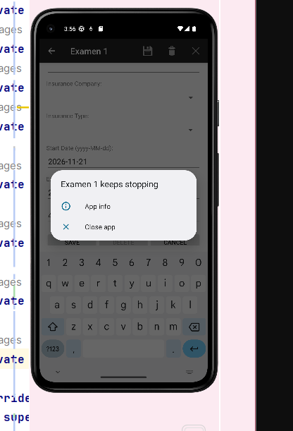
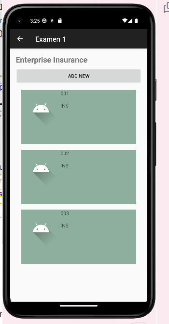

# Evidencia de Errores y Solución

## Problema encontrado: Falta de strings

**Problema:**
El proyecto base no incluye los strings necesarios para los campos de mi escenario. Además, las instrucciones prohíben agregar o modificar strings.

**Solución aplicada:**
Utilicé los strings existentes para botones y mensajes. Para las etiquetas y opciones de los Spinners, mantuve los textos necesarios en inglés, ya que dejarlos vacíos impedía registrar pólizas.

**Resultado:**
El CRUD funciona correctamente.

**Solución recomendada:**
Agregar los strings faltantes en `strings.xml`.
