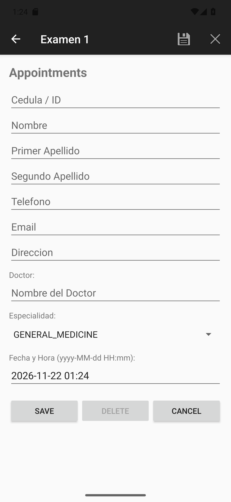
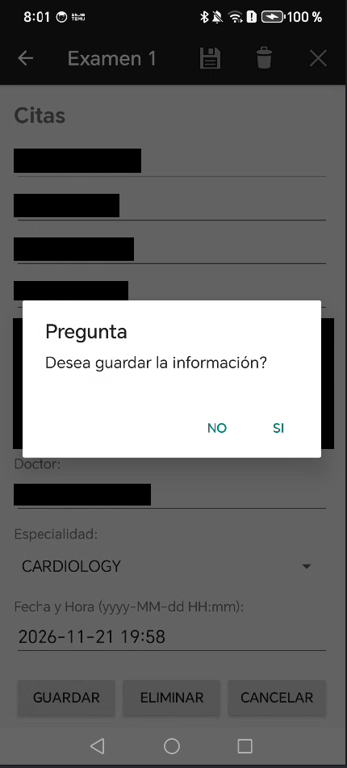

# examenI

## Appointments

- **Student** Pablo Aguero
- **Branch** `pablo-aguero`
- **Base branch** `development` (`c233a95`)

The Appointments screen creates, lists, edits and deletes appointments in the supplied memory repository. It collects the patient and contact details, doctor, specialty, and appointment date and time. The form rejects duplicate IDs and appointments in the past. Editing or deleting an existing appointment requires confirmation.

### Errors and fixes

| Finding | Cause | Fix or proposed fix |
| --- | --- | --- |
| Saving reported success but the appointment did not appear. | In the base activity, the repository calls were commented out and the list always received `emptyList()`. | `AppViewModel` connects the form and list to the same memory repository. The list reads saved appointments when it resumes. |
| Duplicate IDs could be accepted. | The original duplicate check used the constant condition `null != null`. | The view model looks up the ID before adding a record. When editing, the saved ID stays fixed. |
| In the original base, the shared adapter would show the previous record for every row after the first. | The row lookup used `position - 1` for positions greater than zero. | `development` corrected the shared lookup in `c233a95`. The Appointments adapter uses the actual row position and shows the patient name, ID, doctor, specialty, date, and time. |
| The form shows Spanish field hints even when the emulator is set to English. | The starter layout defines hints such as `Nombre` directly in `android:hint`. Android displays each hint only while its field is empty. The supplied English resources cover titles, buttons, and messages, but lack entries for the individual fields and specialty names. | The submitted form preserves the starter hints. The English resource requirement for these labels remains open. With instructor-provided or authorized resources, replace the literal `android:hint` and `android:text` values with `@string` references and use the authorized specialty labels in the dropdown and list. Keep the existing shared string entries. |

### Screenshots and debugging evidence

The first screenshot shows the new form on the emulator with English selected. The supplied device screenshots show a completed form, a saved appointment, and both confirmation dialogs. Personal data is covered.

| New appointment | Saved appointment |
| --- | --- |
|  |  |

| Filled form | Update confirmation | Delete confirmation |
| --- | --- | --- |
|  |  |  |

| Check | Recorded result |
| --- | --- |
| Save an appointment on the original `development` commit `3769c54`. | The emulator log recorded zero rows after the save. |
| Save and reopen an appointment with the restored form, update its address, delete it, and cancel an edit. | Passed on the emulator. |
| Read the appointment details in the list and see the updated doctor after editing. | Passed on the emulator. |
| Reject duplicate IDs and past or invalid dates. | Passed on the earlier layout using the same validation logic. |

[Emulator log and source findings](docs/appointments/evidence/debugging.txt)
