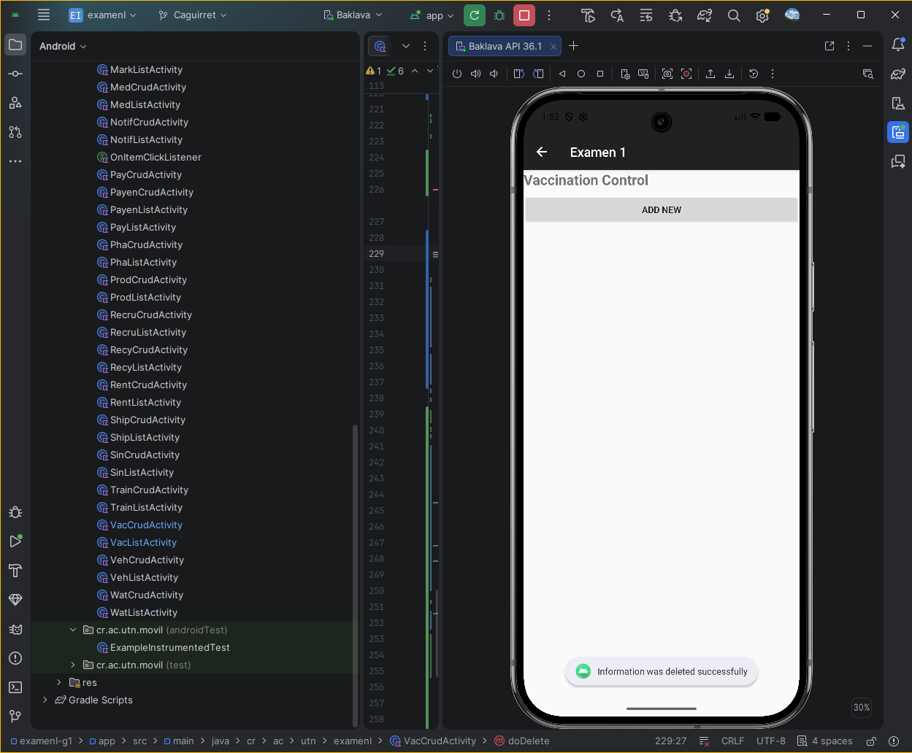

# examenI

## Vaccination Control - Carlos

**Student:** Carlos

**Branch:** `Caguirret`

**Scenario:** 2 - Vaccination Control

**Course:** Mobile Devices Programming I

### 1. Description

This module implements vaccination record management for patients.

The application allows users to register, view, update, and delete vaccination records using an in-memory repository.

Each record contains patient information, vaccine type, vaccination location, and vaccination date and time.

### 2. Implementation

The following components were implemented or updated:

| File | Responsibility |
|---|---|
| `VacRecord.kt` | Vaccination entity extending `Person`. |
| `VacViewModel.kt` | CRUD operations and duplicate validation. |
| `VacCrudActivity.kt` | Registration, editing, deletion, and input validation. |
| `VacListActivity.kt` | Display of vaccination records. |
| `ListAdapter.kt` | Correction of an indexing error authorized by the professor. |

The implementation follows object-oriented programming principles, including inheritance, encapsulation, and separation of responsibilities.

### 3. Functional Testing

The application was tested using the Android Studio emulator.

| Test | Result |
|---|---|
| Create vaccination record | Passed |
| Display registered patients | Passed |
| Update patient information | Passed |
| Delete vaccination record | Passed |
| Confirm deletion | Passed |
| Reject duplicate identifiers | Passed |
| Reject empty identifiers | Passed |
| Reject future vaccination dates | Passed |
| Build Android application | Passed |

### 4. Evidence

**Registration and listing**

**Update operation**

**Delete operation**

**Validation tests**

### 5. Original Code Issues

During development, several issues were identified in the original project.

**Issue 1: Incorrect RecyclerView indexing**

File: `ListAdapter.kt`

The original implementation selected the previous element for positions greater than zero, causing duplicate entries and incorrect visualization.

**Solution:** The adapter was updated to use `items[position]`, with explicit authorization from the professor.

**Issue 2: Missing duplicate validation in the repository**

File: `MemoryManager.kt`

The original `add()` method inserts elements without checking duplicate identifiers.

**Recommended solution:** Implement identifier validation before inserting records.

The original repository was preserved. Duplicate validation was implemented in `VacViewModel`.

**Issue 3: Record position changes during updates**

File: `MemoryManager.kt`

The original `update()` implementation deletes an existing record and appends it again, potentially changing its position.

**Recommended solution:** Replace the matching element directly.

**Issue 4: Mutable internal collection exposure**

File: `MemoryManager.kt`

The `getAll()` method returns the internal mutable collection directly.

**Recommended solution:** Return a defensive copy or read-only representation of the collection.

The original implementation was not modified.

### 6. Known Limitations

\- Records are stored in memory and are not persisted after the application process terminates.

\- The current implementation uses the patient identifier as the vaccination record identifier, allowing only one record per identifier.

\- Existing string resources are reused according to the examination restrictions. Some validation messages are generic.

\- The original shared infrastructure contains limitations documented above.

### 7. Build Verification

The project was compiled using the Gradle Wrapper:

`.\\gradlew.bat :app:assembleDebug`

**Result:** `BUILD SUCCESSFUL`

### 8. Conclusion

The vaccination management module successfully implements the four CRUD operations and validates required information, duplicate identifiers, and vaccination dates.

The development process included implementation, compilation, emulator testing, identification of original code issues, and documentation of technical findings.

The project preserves the restricted shared components, except for the explicitly authorized adapter correction.
