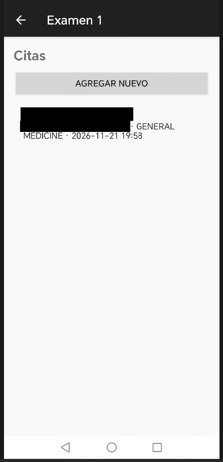
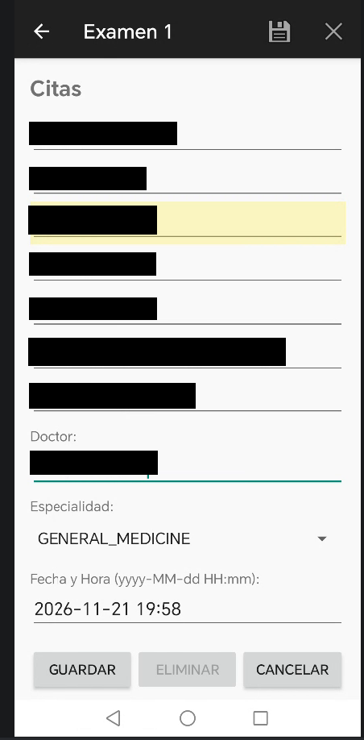
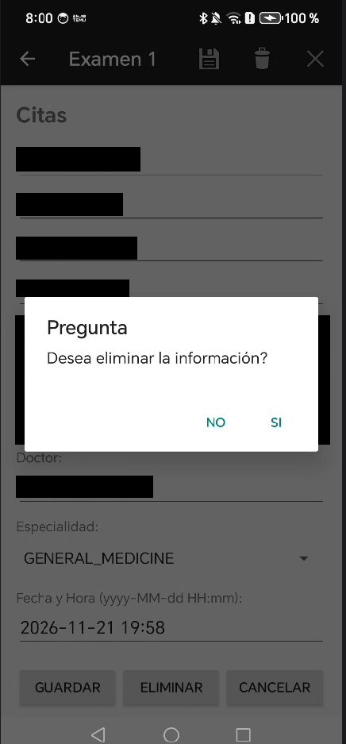

# examenI

## Citas

- **Estudiante** Pablo Aguero
- **Rama** `pablo-aguero`
- **Rama base** `development` (`c233a95`)

La pantalla de Citas permite crear, listar, editar y eliminar citas con el repositorio en memoria del proyecto base. El formulario registra los datos personales y de contacto del paciente, el nombre del médico, la especialidad, la fecha y la hora. Valida que el ID sea único y que la fecha y hora de la cita sean posteriores al momento del guardado. Al editar o eliminar una cita existente, pide confirmación.

### Errores y soluciones

| Error encontrado | Causa | Solución aplicada o propuesta |
| --- | --- | --- |
| Al guardar, la aplicación mostraba un mensaje de éxito y la cita seguía sin aparecer en el listado. | Las llamadas al repositorio estaban comentadas en el proyecto base y el listado siempre recibía `emptyList()`. | `AppViewModel` conecta el formulario y el listado al mismo repositorio en memoria. El listado vuelve a consultar las citas guardadas al abrirse o al volver del formulario. |
| El formulario podía aceptar IDs duplicados. | La validación original usaba la condición `null != null`, que siempre da falso. | El modelo de vista busca el ID antes de crear una cita. Al editar, el ID de la cita permanece fijo. |
| En el proyecto base original, el adaptador compartido mostraba el registro anterior en cada fila a partir de la segunda. | El adaptador usaba `position - 1` para las posiciones mayores que cero. | El cambio `c233a95` de `development` corrigió el índice del adaptador compartido. El adaptador de Citas usa la posición de la fila y muestra el nombre del paciente, el ID, el médico, la especialidad, la fecha y la hora. |
| Los textos de ayuda del formulario aparecen en español incluso cuando el emulador está configurado en inglés. | El diseño original define textos como `Nombre` directamente en `android:hint`. Android muestra cada ayuda mientras su campo está vacío. Los recursos en inglés del proyecto base cubren títulos, botones y mensajes. Hacen falta las entradas de cada campo y de las especialidades. | El formulario entregado conserva los textos de ayuda originales. El requisito de inglés queda pendiente para esas etiquetas. Si el profesor proporciona o autoriza los recursos, se pueden sustituir los valores directos de `android:hint` y `android:text` por referencias `@string`, usar las traducciones autorizadas en el selector y el listado, y conservar las entradas compartidas existentes. |

### Capturas y evidencias de depuración

La primera captura muestra el formulario para una cita nueva en el emulador configurado en inglés. Las capturas del dispositivo muestran el formulario lleno, una cita guardada y los dos diálogos de confirmación. Los datos personales están cubiertos.

| Cita nueva | Cita guardada |
| --- | --- |
|  |  |

| Formulario lleno | Confirmación de edición | Confirmación de eliminación |
| --- | --- | --- |
|  |  |  |

| Prueba | Resultado registrado |
| --- | --- |
| Guardar una cita en el commit original `3769c54` de `development`. | El registro del emulador mostró cero filas después de guardar. |
| Guardar y volver a abrir una cita con el formulario restaurado, cambiar su dirección, eliminarla y cancelar una edición. | Pasó en el emulador. |
| Consultar los detalles de la cita en el listado y comprobar el cambio de médico después de editarla. | Pasó en el emulador. |
| Rechazar IDs duplicados y fechas pasadas o inválidas. | Pasó con la versión anterior del formulario, que usaba la misma lógica de validación. |

[Registro del emulador y hallazgos del código](docs/appointments/evidence/debugging.txt)
