# Mi parte del examen: Payroll

Me tocó el escenario 13 de nómina. Trabajé en la rama `sharon`, que creé desde `development`.

El proyecto ya traía las pantallas, entonces fui revisando lo que faltaba y corrigiendo los problemas que encontraba para que se pudiera guardar, consultar, modificar y eliminar la información de los empleados.

## Primero probé la aplicación

Abrí el proyecto en Android Studio y lo ejecuté en mi celular Xiaomi. La aplicación se instaló correctamente y pude entrar a la opción Payroll desde el menú principal.

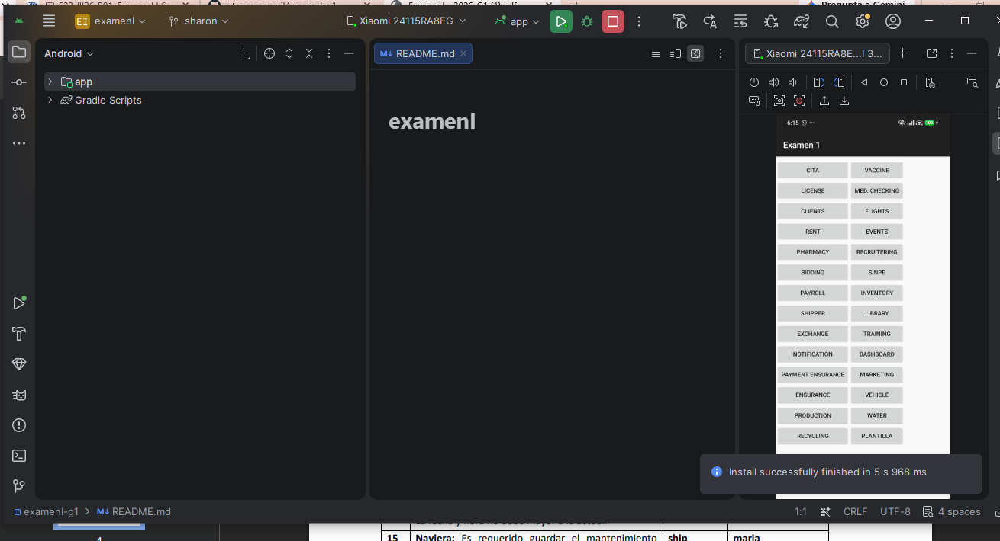

Así aparecía la pantalla de Nómina al principio.

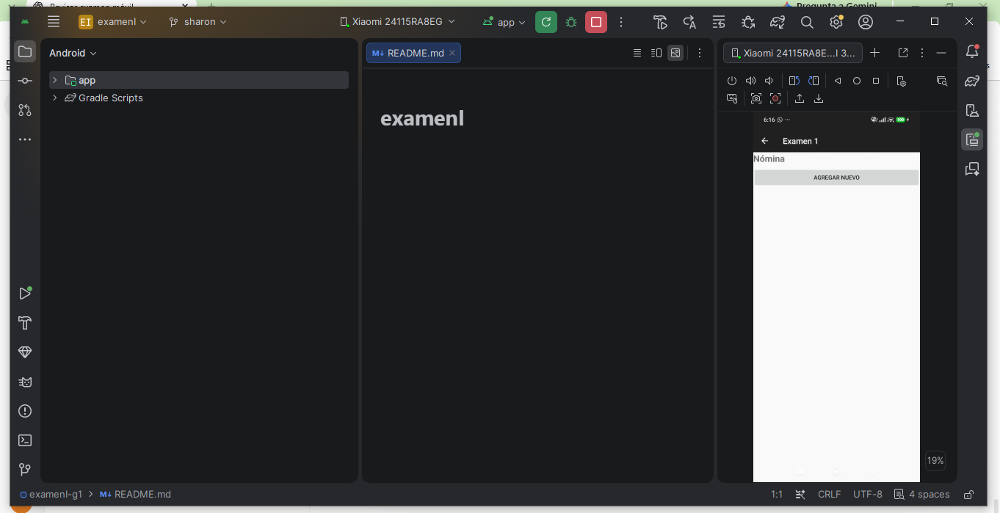

Este era el formulario que ya tenía el proyecto.

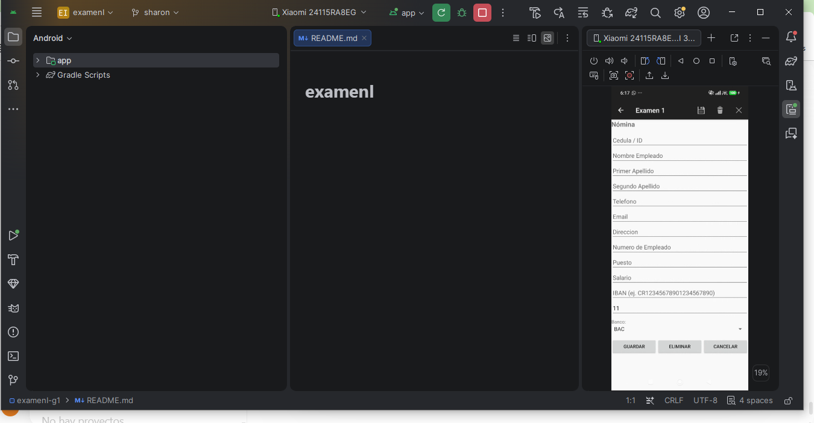

## Error 1: la lista aparecía vacía

Cuando entré a Nómina, la lista no mostraba los registros.

Revisando el código de `PayListActivity`, encontré que la función `loadData()` tenía `emptyList()`, por lo que siempre mostraba una lista vacía.

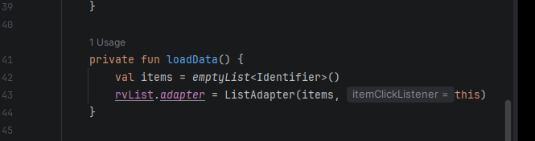

Para solucionarlo, cambié esa parte y utilicé `PayViewModel.getAll()` para que cargara los registros guardados.

Después compilé el proyecto para comprobar que no tuviera errores.

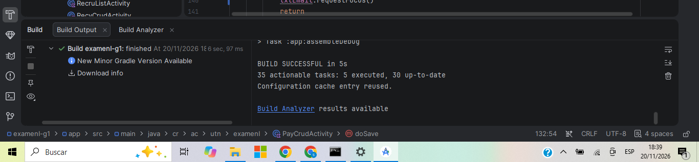

Una vez que terminé de conectar el guardado, los empleados ya aparecían en la lista.

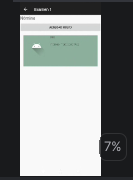

## Error 2: los datos no aparecían al consultar

Después de guardar un empleado, noté que al seleccionarlo para ver su información, el formulario abría, pero todos los campos aparecían vacíos.

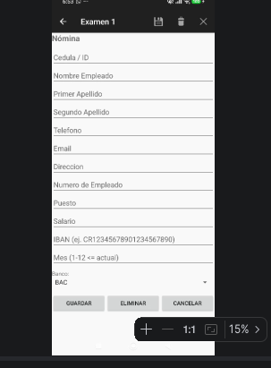

Entonces revisé `PayCrudActivity` y encontré que la función `loadExistingData()` estaba comentada.

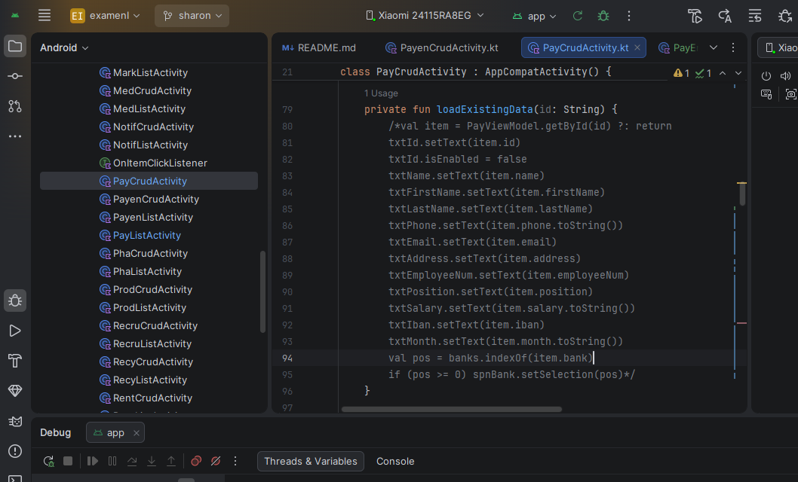

Lo que hice fue quitar los comentarios `/*` y `*/` para activar el código que ya había dejado el profesor.

Volví a compilar y comprobé que no aparecieran errores.

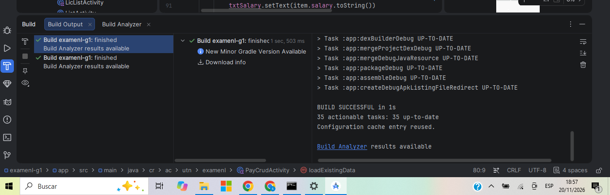

Después abrí nuevamente el empleado y esta vez sí aparecieron todos sus datos.

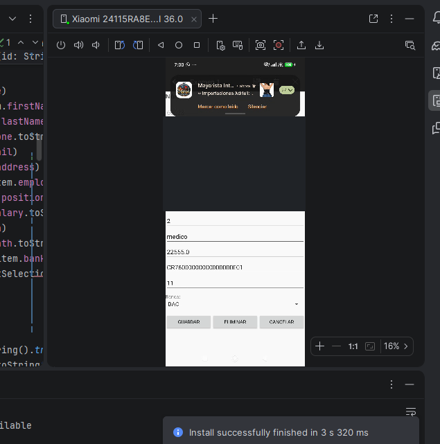

## Error 3: el botón eliminar no eliminaba

Cuando probé eliminar un empleado, el sistema preguntaba si estaba seguro y después mostraba que la información había sido eliminada.

El problema era que el empleado seguía apareciendo en la lista.

Revisé la función `doDelete()` y encontré que la línea `PayViewModel.delete(id)` estaba comentada.

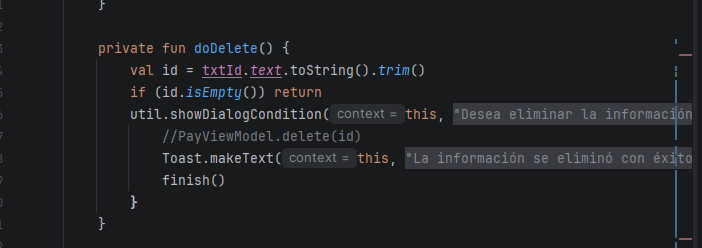

Para corregirlo, únicamente quité las dos barras `//` de esa línea, sin cambiar el resto de la función que había dejado el profesor.

Volví a probar y ahora sí eliminaba el registro correctamente.

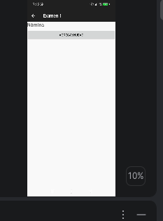

## Guardar y modificar empleados

También trabajé en la función `doSave()` para poder guardar y modificar la información de los empleados.

Creé las clases `PayEmployee` y `PayViewModel` para manejar la información utilizando el administrador de memoria que ya traía el proyecto.

Utilicé el debugger de Android Studio para revisar los datos que estaba recibiendo mientras se ejecutaba el guardado.

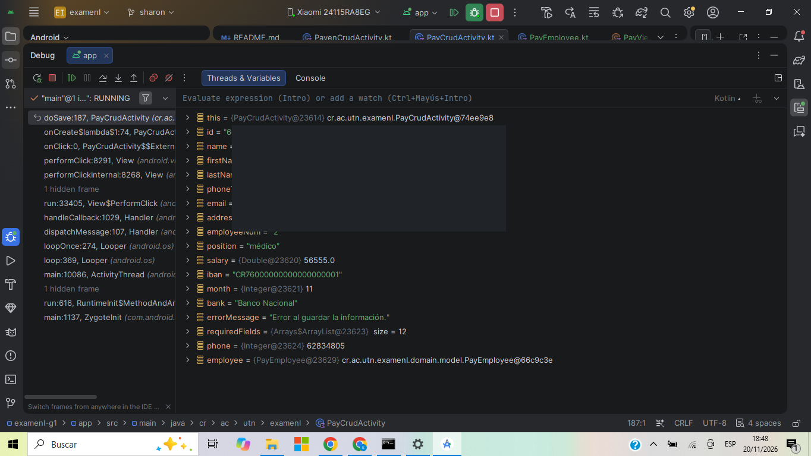

Después hice las pruebas desde el celular. Pude registrar empleados, abrirlos, modificar el salario y comprobar que los cambios quedaran guardados.

## Validaciones realizadas

**Registros duplicados**

Probé ingresar un empleado con una identificación que ya estaba registrada. El sistema mostró el mensaje de que la información ya se encontraba almacenada y no permitió guardar el duplicado.

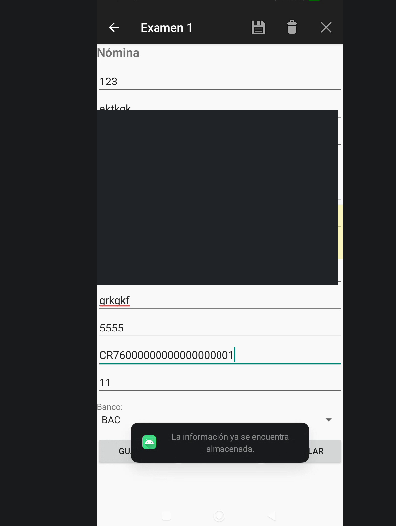

**Mes de pago**

Probé colocar el mes 12 cuando todavía estábamos en noviembre. El programa marcó el campo como incorrecto y no permitió guardar.

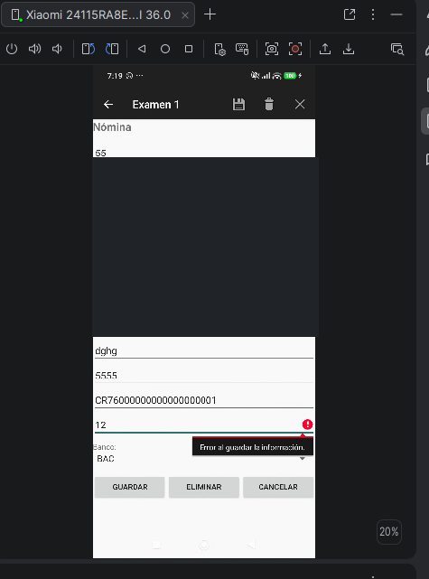

**Salario**

También probé colocar el salario en 0. El sistema mostró un error y no permitió guardar ese registro.

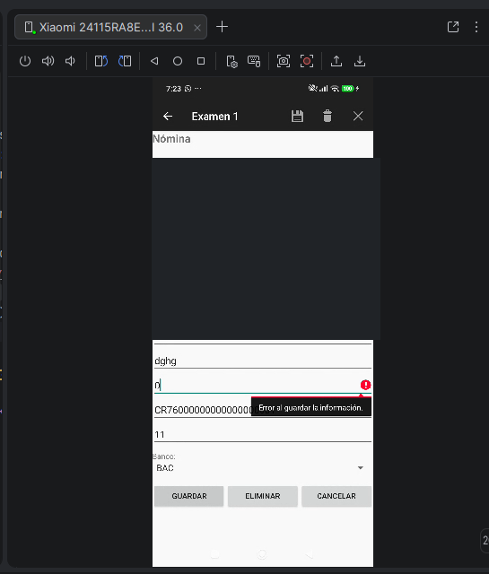

**Cuenta IBAN**

Agregué la validación del IBAN de Costa Rica para comprobar que tenga el formato correspondiente y que cumpla con el cálculo MOD 97.

Esta validación quedó implementada en el código. No agregué una imagen específica de una prueba con IBAN incorrecto 

## Archivos que trabajé

Los archivos que utilicé para mi parte fueron:

- `PayCrudActivity.kt`
- `PayListActivity.kt`
- `PayEmployee.kt`
- `PayViewModel.kt`

También aparece modificado `ListAdapter.kt`, pero ese cambio fue una corrección de un error que realizamos con el profesor y que él autorizó.

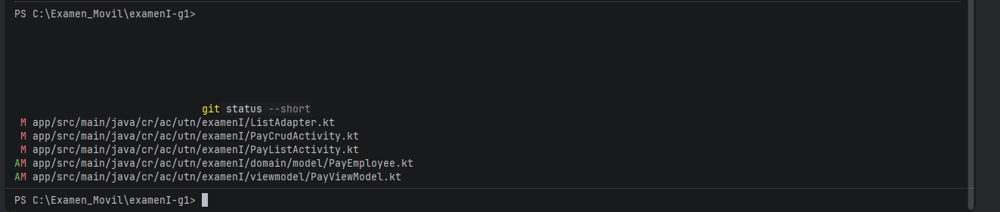

