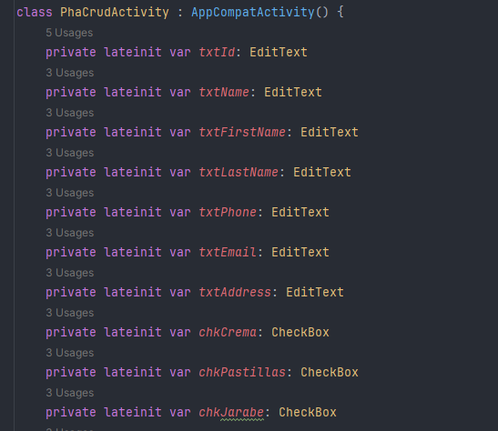
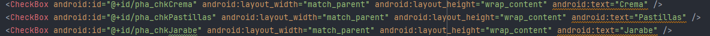
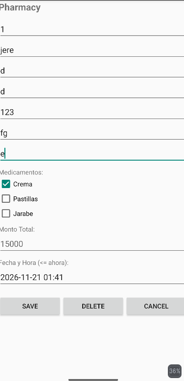
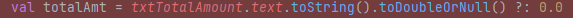
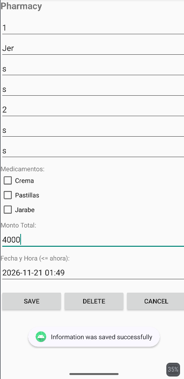
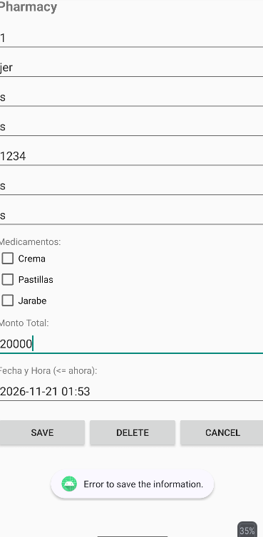
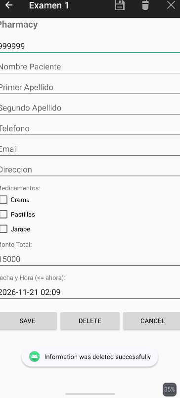
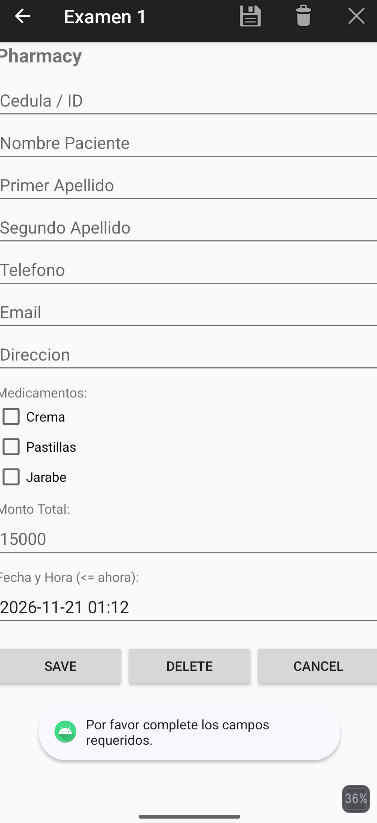
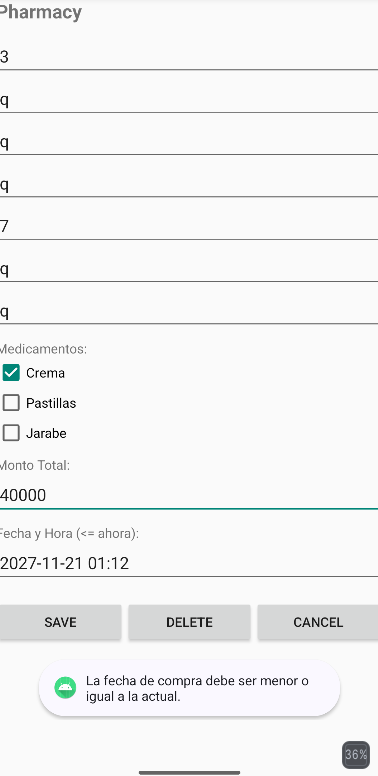

# Jeremy-Pharmacy

## Error 1 — Nombres de variables e ids en español

**Archivos:** `PhaCrudActivity.kt`

**Qué pasaba:** las variables y los ids se llamaban `chkCrema`, `chkPastillas`, `chkJarabe` (`pha_chkCrema`, etc.). El examen exige que los nombres de objetos y variables estén en inglés.






**Solución:**

```
    private lateinit var chkCream: CheckBox
    private lateinit var chkPills: CheckBox
    private lateinit var chkSyrup: CheckBox
...
        chkCream = findViewById(R.id.pha_chkCream)
        chkPills = findViewById(R.id.pha_chkPills)
        chkSyrup = findViewById(R.id.pha_chkSyrup)
```
```xml
        <CheckBox android:id="@+id/pha_chkCream" android:layout_width="match_parent" android:layout_height="wrap_content" android:text="Crema" />
        <CheckBox android:id="@+id/pha_chkPills" android:layout_width="match_parent" android:layout_height="wrap_content" android:text="Pastillas" />
        <CheckBox android:id="@+id/pha_chkSyrup" android:layout_width="match_parent" android:layout_height="wrap_content" android:text="Jarabe" />
```

**Explicación:** se renombraron variables e ids al inglés (`chkCream`, `chkPills`, `chkSyrup`) manteniendo el prefijo `pha_`.


---

## Error 2 — Se guarda un monto de 0.0 si el campo está vacío

**Archivo:** `PhaCrudActivity.kt` (línea 91)

**Qué pasaba:** si el monto total se dejaba vacío, el programa lo reemplazaba por 0.0 y guardaba el registro. El monto total es parte del requisito del escenario.






**Solución:**

```
        val totalAmt = txtTotalAmount.text.toString().toDoubleOrNull()
...
        if (totalAmt == null || totalAmt <= 0.0) {
            Toast.makeText(this, getString(R.string.TextSaveError), Toast.LENGTH_SHORT).show()
            return
        }
```

**Explicación:** ya no se convierte el vacío en 0.0. Si el monto está vacío o no es mayor que cero, se muestra el mensaje de error (string existente `TextSaveError`) y no se guarda.


---

## Error 3 — Se puede guardar sin seleccionar ningún medicamento

**Archivo:** `PhaCrudActivity.kt` (líneas 105-110)

**Qué pasaba:** el escenario trata de pacientes que compraron medicamentos, pero el formulario dejaba guardar sin marcar ninguno.




**Código que tenía:**

```
        val selectedMeds = mutableListOf<String>()
        if (chkCrema.isChecked) selectedMeds.add("Crema")
        if (chkPastillas.isChecked) selectedMeds.add("Pastillas")
        if (chkJarabe.isChecked) selectedMeds.add("Jarabe")
```

**Solución:**

```
        if (selectedMeds.isEmpty()) {
            Toast.makeText(this, getString(R.string.TextSaveError), Toast.LENGTH_SHORT).show()
            return
        }
```


**Explicación:** se valida que haya al menos un medicamento marcado antes de guardar.


---

## Error 4 — Eliminar un registro que no existe muestra "eliminado con éxito"

**Archivo:** `PhaCrudActivity.kt` (líneas 138-139)

**Qué pasaba:** en "Add New", si se escribe un ID y se pulsa Delete, pregunta si desea eliminar y luego dice que se eliminó con éxito, aunque ese registro nunca existió.





**Solución:**

```private fun doDelete() {
    val id = txtId.text.toString().trim()
    if (id.isEmpty() || PhaViewModel.getById(id) == null) {
        Toast.makeText(this, getString(R.string.TextDataNoFound), Toast.LENGTH_SHORT).show()
        return
    }
    util.showDialogCondition(this, getString(R.string.TextDeleteQuestion)) {
        PhaViewModel.delete(id)
        Toast.makeText(this, getString(R.string.TextDeleteSuccess), Toast.LENGTH_SHORT).show()
        finish()
    }
}
```

**Explicación:** antes de pedir confirmación se comprueba que el registro exista; si no existe, se muestra el string existente `TextDataNoFound`.


---

# Malas prácticas con strings 

El examen no permite agregar strings ni modificar `strings.xml`, y no existen strings para estos textos. Por eso **no se cambiaron**: solo se señala por qué son una mala práctica.


## Error 5 — Mensajes de validación escritos directamente en el código



**Archivo:** `PhaCrudActivity.kt` 

```
            Toast.makeText(this, "Por favor complete los campos requeridos.", Toast.LENGTH_SHORT).show()
            Toast.makeText(this, "La fecha de compra debe ser menor o igual a la actual.", Toast.LENGTH_SHORT).show()
```

**Por qué es una mala práctica:** el texto está fijo dentro del código y en español. No se puede traducir , mezcla idiomas con el resto de la app y para cambiar un mensaje hay que editar código.

**Solución correcta:** crear los strings en `strings.xml` (y `values-en`) y usar `getString(R.string...)`.


---

## Error 6 — Etiquetas y hints del formulario escritos directamente en el layout

**Archivo:** `activity_pha_crud.xml`

```xml
        <EditText android:id="@+id/pha_txtId" android:layout_width="match_parent" android:layout_height="wrap_content" android:hint="Cedula / ID" />
        <EditText android:id="@+id/pha_txtName" android:layout_width="match_parent" android:layout_height="wrap_content" android:hint="Nombre Paciente" />
        <TextView android:layout_width="match_parent" android:layout_height="wrap_content" android:text="Medicamentos:" android:layout_marginTop="8dp"/>
        <CheckBox android:id="@+id/pha_chkCrema" android:layout_width="match_parent" android:layout_height="wrap_content" android:text="Crema" />
```

**Por qué es una mala práctica:** `android:text` y `android:hint` tienen el texto fijo en español ("Cedula / ID", "Nombre Paciente", "Medicamentos:", "Monto Total:", "Crema"…). No usan `@string`, no se traducen con el idioma del dispositivo . 

**Solución correcta :** definir cada texto en `strings.xml` (y `values-en`) y usar `@string/...` en el layout.


---

## Error 7 — Texto "Meds:" escrito directamente en el modelo

**Archivo:** `PhaPharmacy.kt` 

```
        get() = "$name $firstName - Meds: $medicines ($totalAmount)".trim()
```

**Por qué es una mala práctica:** `fullName` es lo que se muestra en la lista y lleva la palabra Meds fija dentro de la clase del modelo.Se mezcla inglés con datos en español.

**Solución correcta :** que el modelo devuelva solo los datos y que el texto de la etiqueta salga de un string en la pantalla que lo muestra.


---

## Error 8 — Nombres de medicamentos repetidos como texto suelto en el código

**Archivo:** `PhaCrudActivity.kt` 

```
        chkCrema.isChecked = item.medicines.contains("Crema")
        chkPastillas.isChecked = item.medicines.contains("Pastillas")
        chkJarabe.isChecked = item.medicines.contains("Jarabe")
...
        if (chkCrema.isChecked) selectedMeds.add("Crema")
        if (chkPastillas.isChecked) selectedMeds.add("Pastillas")
        if (chkJarabe.isChecked) selectedMeds.add("Jarabe")
```

**Por qué es una mala práctica:** "Crema", "Pastillas" y "Jarabe" están escritos 6 veces como texto suelto  y se guardan como un solo `String` que luego se consulta con `contains`. Un error de escritura en cualquiera de las repeticiones rompe la lógica sin avisar, y `contains` sobre texto también acepta fragmentos por ejemplo Crem.

**Solución correcta:** definir los valores una sola vez (constantes, enum o strings) y no depender de texto escrito en varios lugares.


