# Resolución Examen I - Campañas de Marketing - Diana Gómez Alvarado

Escenario 22, prefijo `mark_`, rama `diana`.

## Implementación

Se hizo el CRUD de campañas de marketing.

- `MarkCampaign`: hereda de `Person` (y `Person` de `Identifier`). Además de los datos de la persona guarda código, nombre de la campaña, presupuesto, canal, líder, provincia, fecha de inicio y fecha fin.
- `MarkViewModel`: usa `MemoryDataManager` para listar, buscar, guardar, actualizar y eliminar. También tiene `existsCode` para revisar si el código ya existe.
- `MarkCrudActivity`: formulario con Spinner de canal (Digital, TV, Radio), Spinner de provincia y DatePicker para las fechas. Se puede guardar, eliminar y cancelar con los botones o con el menú.
- `MarkListActivity`: muestra las campañas en un RecyclerView y al tocar una se abre para editarla.

Validaciones: campos obligatorios, presupuesto mayor a 0, canal dentro del catálogo, fecha de inicio no mayor a la fecha fin, y no se permite repetir el código ni la cédula.

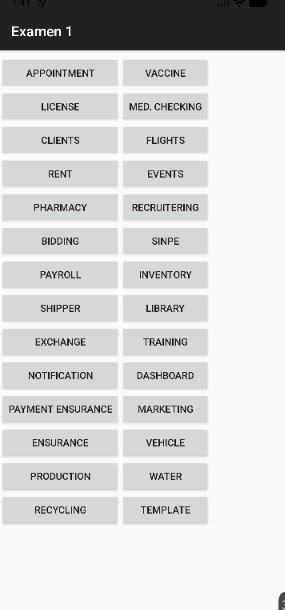

## Errores encontrados

### Error 1: Canal fuera del catálogo
En `MarkCrudActivity` la lista de canales tenía `"Prensa"`, que no está en el catálogo (Digital, TV, Radio), entonces se podía guardar un canal no permitido. Se quitó y se valida con `channels.contains(channel)`.

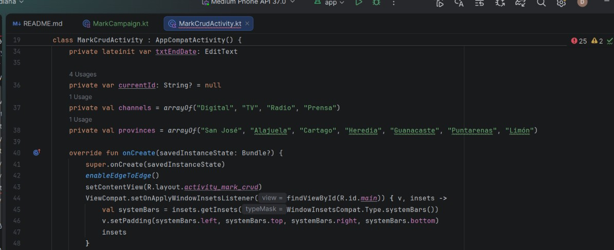

### Error 2: Nunca se detectaban duplicados
En `doSave` la validación era `if (null != null)`, que siempre da falso. Se cambió por `markViewModel.getById(id) != null || markViewModel.existsCode(codeVal)`. Con un breakpoint en esa línea, al guardar otra campaña con el código `C1`, `existsCode(codeVal)` dio `true` y salió el mensaje de duplicado.

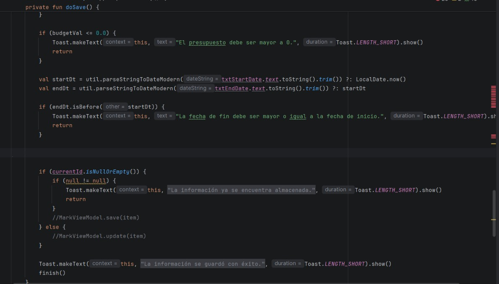
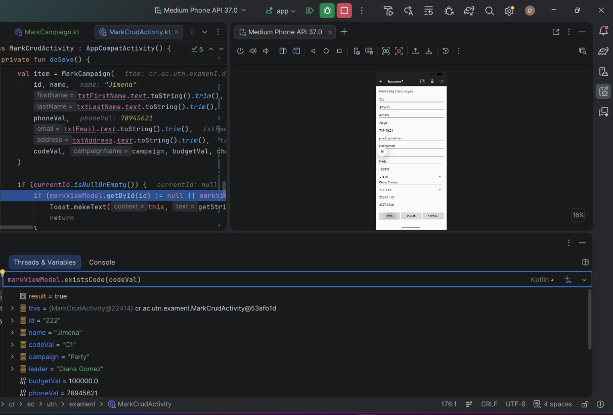
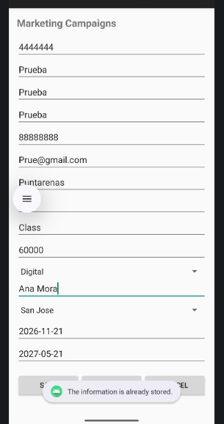

### Error 3: Fechas inválidas se aceptaban
En `doSave` las fechas usaban `?: LocalDate.now()`, entonces si la fecha venía mal se cambiaba por la de hoy sin avisar y la validación se podía saltar. Ahora las fechas se eligen con DatePicker y si la fecha de inicio es mayor a la fecha fin no se guarda.

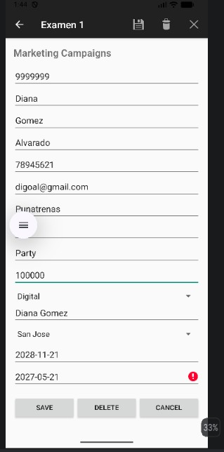

### Error 4: La lista siempre salía vacía
En `MarkListActivity`, `loadData` usaba `emptyList<Identifier>()`, entonces nunca se veían las campañas guardadas. Se cambió por `markViewModel.getAll()`.

### Error 5: Posiciones incorrectas en el RecyclerView
La lista repetía la primera campaña y no mostraba la última. Con un breakpoint en `onBindViewHolder` de `ListAdapter` vi que en `position = 1` el `item` era `C1`, por el `position - 1`. Se cambió a `items[position]`.

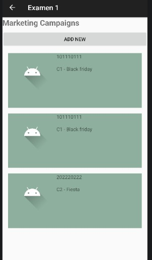
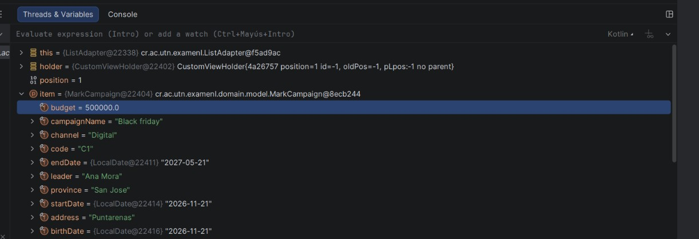
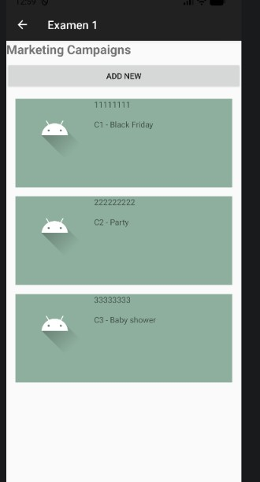

## Funcionalidad que faltaba

En `MarkCrudActivity` estaban comentados `loadExistingData`, `save`, `update` y `delete`, entonces no se guardaba, cargaba ni eliminaba nada. Se creó `MarkViewModel` y se activaron esas llamadas.

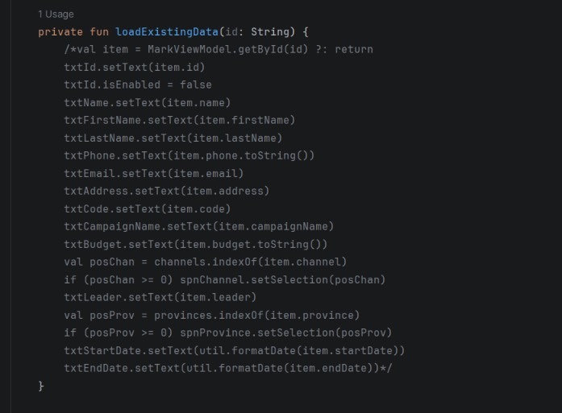
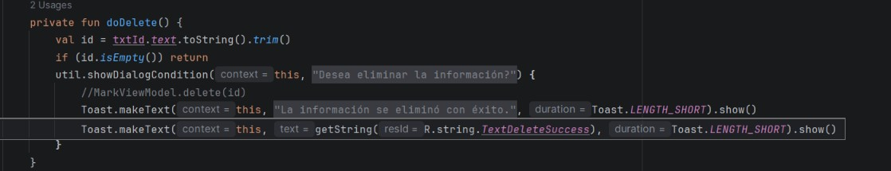

## Malas prácticas corregidas en mis archivos

1. Los Toast, hints y labels tenían texto en español escrito directamente. Ahora los mensajes usan los strings que ya existen (`TextSaveError`, `TextDuplicateData`, `TextSaveSuccess`, etc.) y se quitaron los textos escritos a mano del layout.
2. Las provincias estaban en español con tildes. Se dejaron en inglés sin tildes.
3. Eliminar usaba lo que estuviera escrito en el campo de cédula y podía intentar borrar algo que no existía. Ahora usa el id de la campaña cargada y si no existe muestra `TextDataNoFound`.
4. Los ids del layout no tenían prefijo. Se cambiaron a `mark_` (por ejemplo `mark_txtCode`, `mark_btnSave`).

## Malas prácticas en archivos que no se pueden modificar

1. `MemoryManager.kt`: la clase se llama `MemoryDataManager` y no es singleton, entonces cada pantalla que hace `MemoryDataManager()` tiene su propia lista. Solución: hacerla `object MemoryManager`. En mi caso se usó una sola instancia en el `companion object` de `MarkViewModel` para que la lista y el formulario compartan los datos.
2. `Person.kt`: `phone` es `Int`, se pierden ceros a la izquierda y no acepta `+506`. Solución: usar `String`.
3. `util.kt`: la clase se llama `util` en minúscula. Solución: llamarla `Util`.
4. `strings.xml`: no hay strings para las etiquetas del formulario (código, presupuesto, canal, fechas) y no se pueden agregar, por eso el formulario no tiene hints. Solución: agregar strings como `mark_hint_code`, `mark_hint_budget`, `mark_hint_start_date`. Además el idioma por defecto está en español y el inglés en `values-en`.
5. `AndroidManifest.xml`: declara `TemplateListActivity`, que no existe. Solución: quitarla o crear la clase.
6. `activity_main.xml`: los botones del menú principal tienen el texto escrito directamente (ej. `"Marketing"`). Solución: usar los strings `*_title` que ya existen.

## Pruebas de funcionamiento

Presupuesto en 0:

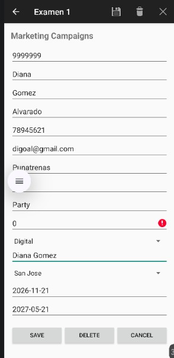

Actualizar:

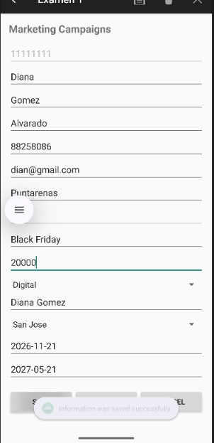

Eliminar:

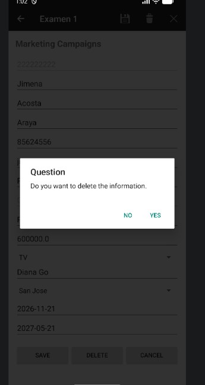
